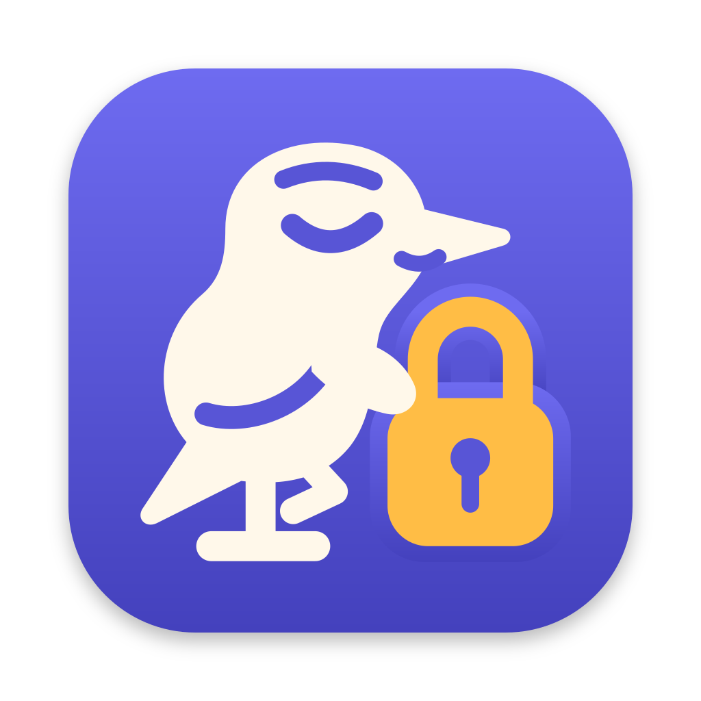
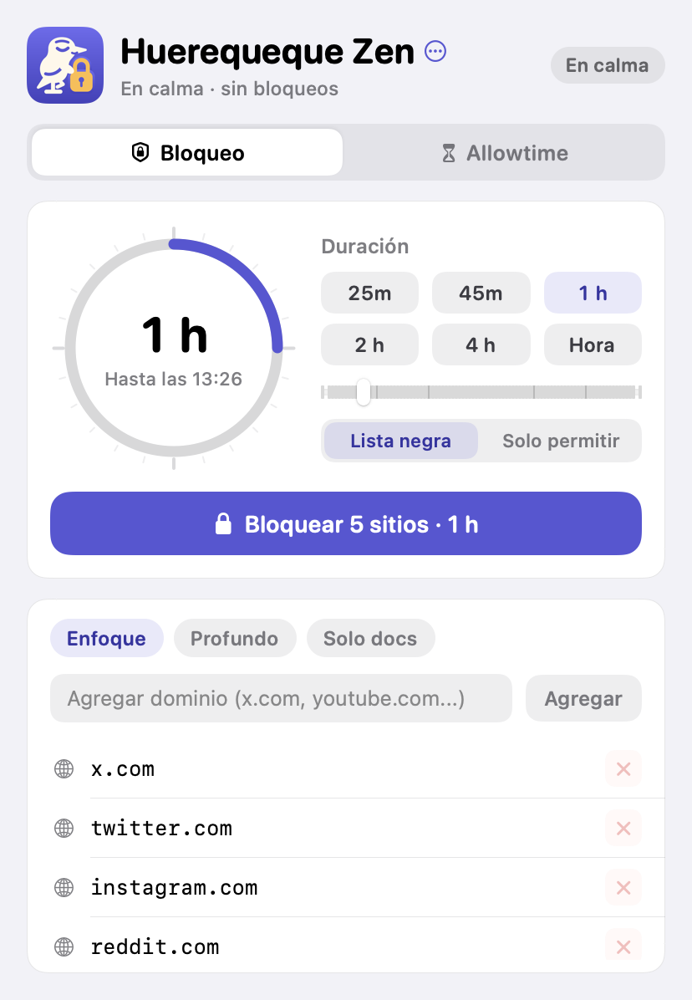
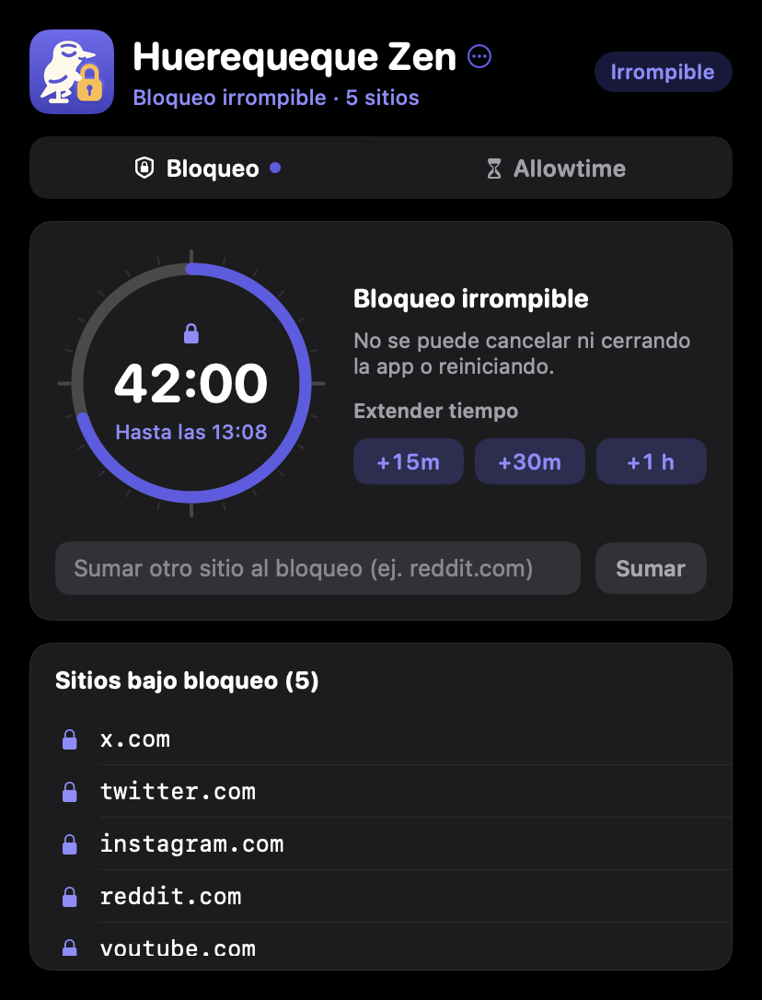
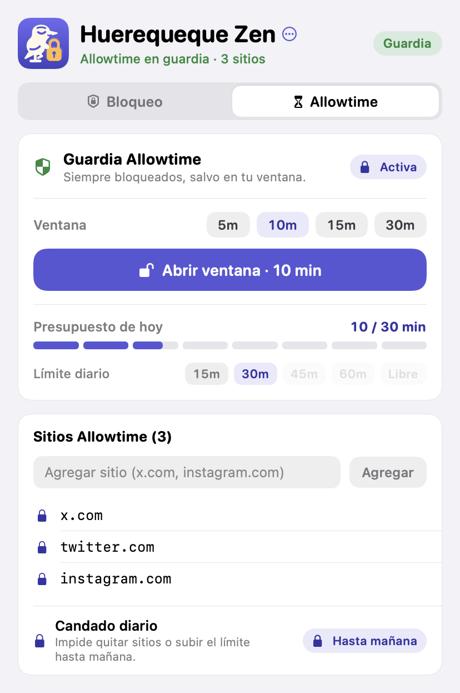
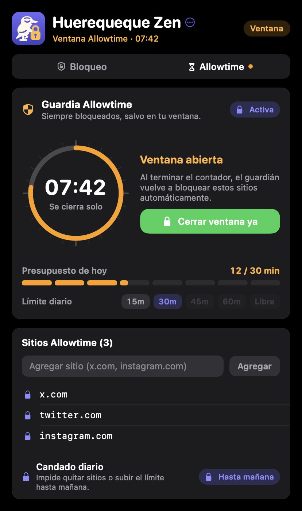

<p align="center">
  
</p>

<h1 align="center">Huerequeque Zen</h1>

<p align="center">
  Bloqueador irrompible de sitios en la barra de menú de macOS, con sesiones <strong>On-Demand</strong> y modo <strong>Allowtime</strong> para sitios extra distractorios.
</p>

<p align="center">
  <code>macOS 13+</code> · <code>Swift &amp; SwiftUI</code> · <code>Sin dependencias</code> · <code>100% local</code>
</p>

---

<p align="center">
  
  &nbsp;&nbsp;
  
</p>

<p align="center">
  
  &nbsp;&nbsp;
  
</p>

## Qué hace

- **Bloqueo irrompible (On-Demand):** bloquea tu lista negra (o activa el modo **Solo permitir**) por presets (`25m` a `4 h`), slider o hasta una hora exacta (`Hasta las HH:MM`). Una vez iniciado, **no se puede cancelar ni acortar**, ni cerrando la app ni reiniciando el Mac; solo puedes extender el tiempo o sumar más dominios.
- **Modo Allowtime (extra distractorios):** pensado para sitios como `x.com`, `twitter.com` o `instagram.com`. Los mantiene bloqueados 24/7 por defecto y te deja abrir ventanas cortas (`5`, `10`, `15` o `30 min`) con un **presupuesto diario** visual, cierre anticipado para ahorrar minutos y un **Candado diario** opcional que impide aflojar las reglas hasta mañana. Al terminar la ventana, el guardián vuelve a cerrar el paso automáticamente.
- **Perfiles e importación de SelfControl:** perfiles editables (`Enfoque`, `Profundo`, `Solo docs`) e importación en un clic desde tu lista guardada en SelfControl.
- **Solo barra de menú:** popover nativo claro/oscuro (`LSUIElement`), sin Dock, sin cuentas, sin nube ni telemetría. Atajos de teclado: `⌘1` (Bloqueo), `⌘2` (Allowtime), `⌘↩` (acción principal), `⌘Z` (deshacer edición de lista).

## Cómo funciona el bloqueo irrompible

La app incluye un guardián ligero en Swift (`huerequeque-zen-daemon`) que se instala **una sola vez** como `LaunchDaemon` en `/Library/LaunchDaemons/com.santiagodetuna.huerequeque-zen.daemon.plist`:

1. **`/etc/hosts` atómico:** gestiona únicamente su sección delimitada (`# BEGIN HUEREQUEQUE-ZEN BLOCK`) sin tocar el resto del archivo, expandiendo `www.` y subdominios móviles (`m.`, `mobile.`).
2. **Firewall `pf`:** escribe y carga su propio anchor (`/etc/pf.anchors/com.santiagodetuna.huerequeque-zen`) para bloquear IPv4/IPv6 incluso frente a DNS-over-HTTPS y QUIC/HTTP3, y cierra al instante conexiones ya abiertas con `pfctl -k`.
3. **Caché DNS y supervivencia a reinicios:** vacía `mDNSResponder` al activar/desactivar, verifica integridad periódicamente y guarda su estado en `/Library/Application Support/HuerequequeZen/state.json` (propiedad de `root:wheel`).
4. **Invariantes en el daemon:** la app se comunica por un socket Unix (`/var/run/huerequeque-zen.sock`) validado con `getpeereid()`. El protocolo no tiene comando de cancelación ni de reducción de tiempo.

## Compilar e instalar

Requisitos: macOS 13 o posterior y Command Line Tools (`swiftc`). No requiere Xcode completo ni paquetes externos.

```sh
./scripts/test.sh         # 66 pruebas unitarias y de integración
./scripts/build-app.sh    # compila app + daemon root, genera AppIcon.icns y firma ad hoc
./scripts/install-app.sh  # instala en /Applications/Huerequeque Zen.app
./scripts/preview.sh      # genera capturas claro/oscuro en .build/previews/
```

Al abrir `/Applications/Huerequeque Zen.app`, haz clic en el huerequeque de tu barra de menú y pulsa **Activar** una sola vez para autorizar la instalación del guardián root.

### Desinstalar el guardián

Cuando no haya un bloqueo irrompible activo:

```sh
sudo ./scripts/uninstall-daemon.sh
```

## Estructura

- `Sources/Shared/`: modelos, normalizador de dominios, editor de `/etc/hosts`, generador de reglas `pf`, IPC por socket Unix y tokens visuales (`LlamaTheme.swift`).
- `Sources/Daemon/`: máquina de estados con invariantes (`DaemonCore.swift`), implementador macOS (`MacOSSystemBlocker.swift`) y punto de entrada del `LaunchDaemon`.
- `Sources/App/`: glifo monocromático de barra de menú (`StatusMark.swift`), reloj de vigilia y medidor de presupuesto (`ZenDial.swift`), estado (`ZenStore.swift`), interfaz (`Panel.swift`) y `main.swift`.
- `scripts/render-icon.mjs`: genera el icono vectorial del Huerequeque Zen en SVG y PNG.

## Licencia

MIT · Yusef Simon · Santiago de Tuna Computer.
